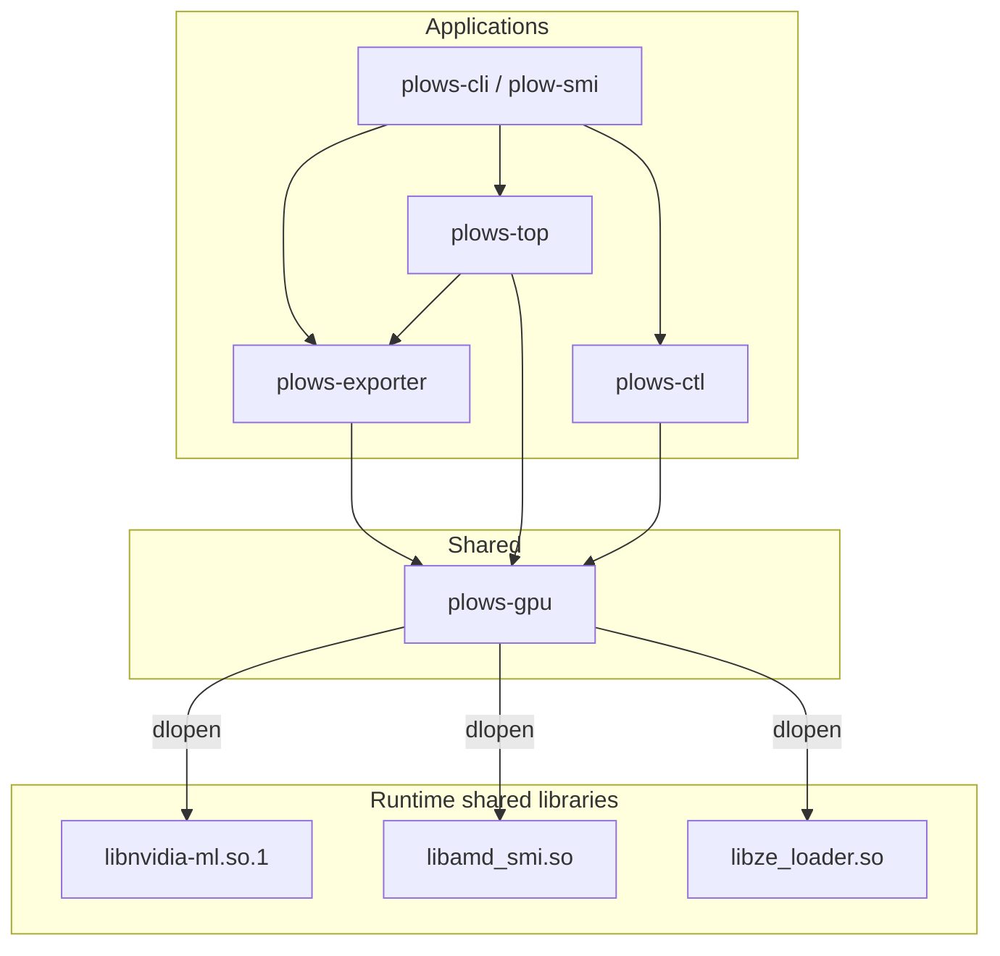

# Architecture

Plow SMI is a Cargo workspace centered on a single GPU abstraction crate that loads vendor libraries at runtime.

## High-level layout



## Why runtime loading?

- Compile and CI without CUDA / ROCm / oneAPI SDKs
- Ship one binary for CPU-only and multi-GPU machines
- Fail soft when a vendor `.so` or symbol is missing

`plows-gpu` uses [`libloading`](https://docs.rs/libloading) to `dlopen` candidate sonames, resolves typed function pointers once into an `*Api` struct, and keeps the `Library` handle alive for the backend lifetime.

## `plows-gpu`

```
crates/plows-gpu/src/
  lib.rs
  device.rs          Vendor, GpuDevice
  metrics.rs         GpuBackend trait, DeviceMetrics
  process.rs         GpuProcessInfo
  loader.rs          GpuManager::discover()
  error.rs
  backend/           NvidiaBackend, AmdBackend, IntelBackend
  ffi/               dynlib + NVML / AMD SMI / Level Zero ABI
```

**Discovery:** try NVIDIA, AMD, and Intel independently. Successes stay active together.

**Public surface:**

- Metrics: `utilization`, memory, temperature, power, fan, clocks
- Identity: uuid, model, PCI bus id, serial
- Processes: NVML compute/graphics occupancy
- Control (NVIDIA/AMD): power limit, application clocks, perf level, reset

**Unsafe** driver calls stay in `ffi/`; backend thread-safety implementations are documented alongside their handles. Callers use owned Rust types only.

**Apple Silicon:** `AppleBackend` owns a one-second sampler thread with
thread-confined runtime-loaded IOReport/IOKit handles. `refresh()` reads an
immutable cached snapshot. Optional `DeviceMetrics::soc` reuses `EngineMetrics`
for CPU/NPU/tier telemetry; unified RAM is separate from GPU VRAM. Unsupported
metrics remain absent. See [DESIGN_APPLE_SILICON.md](DESIGN_APPLE_SILICON.md).

## Applications

| App | How it uses `plows-gpu` |
|-----|----------------------|
| **plows-exporter** | `collector::gpu::GpuCollector` → `GpuManager` → `GpuSnapshot` → Prometheus |
| **plows-top** | Same collector via exporter lib; processes from `plows-gpu` |
| **plows-ctl** | `NvidiaBackend` / `AmdBackend` directly for list/info/set |
| **plows-cli** | Thin subcommands over exporter / top / ctl |

## Vendor filter (exporter)

CLI flags `--nvidia`, `--amd`, `--intel`, `--apple`, `--all` map to `VendorFilter`.
Filtered discovery probes only selected vendors, avoiding unused sampler threads.

## Adding a vendor

1. `ffi/<vendor>.rs` — ABI + `load()` + symbol table  
2. `backend/<vendor>.rs` — implement `GpuBackend` (+ control if needed)  
3. Register in `GpuManager::discover`  
4. Extend `Vendor` (`#[non_exhaustive]`)  

Public `GpuBackend` / `GpuManager` APIs stay stable.

## What was removed

Former crates **`is-nvidia`** (`nvml-wrapper`) and **`is-amd-ffi`** are gone. All telemetry and control go through **`plows-gpu`** dlopen paths so the workspace has one GPU integration layer.

Both exporter binaries call `plows_exporter::server::run`. Blocking OS/driver
collection and Prometheus encoding use a bounded blocking pool, leaving HTTP
and signal handling on a single async thread. System collectors retain sysinfo
state so CPU and network deltas use consecutive samples. Device-series removal
is tracked for GPUs, disks, network interfaces, and temperature sensors.

The standalone control binary delegates to `plows_ctl::cli`; the unified CLI
shares its CPU, capabilities, and apply handlers. Capability discovery never
calls a setter. Contract version 2 reports available control interfaces rather
than claiming that a permission test has succeeded.
